# Hey, I'm Vernan Shikir.

### Software Engineer · Systems Architecture · Backend Engineering · Cloud Infrastructure

**Third-year Computer Science undergraduate at RV College of Engineering (RVCE), Bengaluru.**

I design and build software systems from the ground up, working across **system architecture, backend development, systems programming, cloud infrastructure, application security, and full-stack engineering**.

My primary focus is understanding how complex systems work internally and engineering them to be reliable, maintainable, secure, and efficient.

I work primarily with **Go, Rust, Python, Java, TypeScript, and PostgreSQL**, exploring everything from low-level infrastructure components to production-oriented business platforms.

---

## What I'm Building

### Bunora Haus — Founder & Lead Software Engineer

**Luxury Commerce · Systems Architecture · Production Infrastructure**

[Official Website](https://bunorahaus.com) · [GitHub Organization](https://github.com/search?q=Bunora-Haus&type=repositories)

I'm the lead software engineer behind **Bunora Haus**, an independently engineered luxury commerce and experiences platform.

I lead its system design, technical architecture, backend engineering, infrastructure, security, and full-stack development.

The platform brings together a ten-engine Go modular monolith, Rust-based traffic control, independent Next.js applications, domain-isolated PostgreSQL persistence, and containerized cloud infrastructure.

**Engineering scope:**

- **System Design & Architecture:** Domain-driven design, modular monolith architecture, explicit service contracts, domain isolation, and distributed-systems principles.
- **Backend Engineering:** Go APIs, transactional business workflows, concurrency, database design, and third-party integration architecture.
- **Systems Programming:** Rust-based request routing, traffic management, rate limiting, backpressure, and resource control.
- **Cloud & DevOps:** Linux, Docker, Cloudflare, reverse proxies, CI/CD, immutable releases, and production deployment engineering.
- **Security Engineering:** Authentication, authorization, secure sessions, TLS, access isolation, encrypted backups, and infrastructure hardening.
- **Full-Stack Development:** Next.js, React, TypeScript, customer-facing experiences, and internal administration systems.

**Core stack:** `Go` · `Rust` · `Next.js` · `TypeScript` · `PostgreSQL` · `Redis` · `Docker` · `Cloudflare`

---

## Engineering Interests

My work and interests span several interconnected areas of computer science:

**Systems Architecture** — Designing maintainable applications, defining component boundaries, and reasoning about system behavior, scalability, and failure modes.

**Backend & Infrastructure Engineering** — Building reliable APIs, database-backed systems, network-facing components, and deployment infrastructure.

**Distributed Systems & Performance** — Exploring concurrency, traffic management, fault tolerance, caching, resource efficiency, and system observability.

**Cybersecurity & Application Security** — Understanding secure system design, authentication, authorization, infrastructure protection, and data isolation.

**AI & Machine Learning** — Exploring intelligent applications, model evaluation, optimization, and practical machine-learning systems.

---

## Technical Stack

| Area | Technologies & Concepts |
|---|---|
| Programming Languages | Go, Rust, Python, Java, TypeScript, JavaScript, SQL |
| Systems Engineering | Concurrency, Networking, Traffic Control, Performance, Resource Management |
| Architecture | System Design, Domain-Driven Design, Modular Monoliths, API Design, Distributed Systems |
| Backend | Go, REST APIs, Authentication, Transaction Processing |
| Frontend | Next.js, React, TypeScript |
| Databases | PostgreSQL, Redis, Relational Modeling, Indexing, Transactions |
| Cloud & DevOps | Linux, Docker, Docker Compose, Cloudflare, GitHub Actions, CI/CD |
| Security | Access Control, Session Security, TLS, Authorization, Infrastructure Security |
| AI & Data | Python, Machine Learning, Data Analysis, Model Evaluation |

---

## Beyond Bunora Haus

I also work on projects involving cloud infrastructure analysis, urban digital systems, operating-system concepts, machine learning, and full-stack applications.

Some of my projects include:

**CloudLens** — Cloud deployment analysis, codebase inspection, and infrastructure optimization.

**CityOS** — Urban digital infrastructure and public-asset management.

**Shadow OS** — Operating-system and systems-engineering exploration.

**Real Estate Investment Advisor** — Data-driven property investment analysis.

You can explore these and my other projects through my [GitHub repositories](https://github.com/vernan06?tab=repositories).

---

## Engineering Philosophy

I prefer building systems that I can understand from the architecture down to the implementation.

That means thinking about more than whether an application works: how its components interact, how data flows through it, what happens when dependencies fail, how it can be deployed safely, and how it can evolve without becoming difficult to maintain.

I'm particularly interested in engineering software where **architecture, performance, security, and operational reliability** are treated as core design considerations.

---

## GitHub Activity

---

### Vernan Shikir

**Lead Software Engineer — Bunora Haus**

*Designing the architecture. Building the systems. Engineering the infrastructure.*
